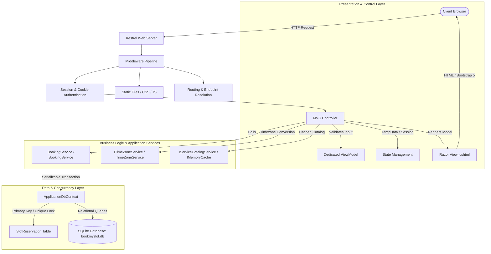
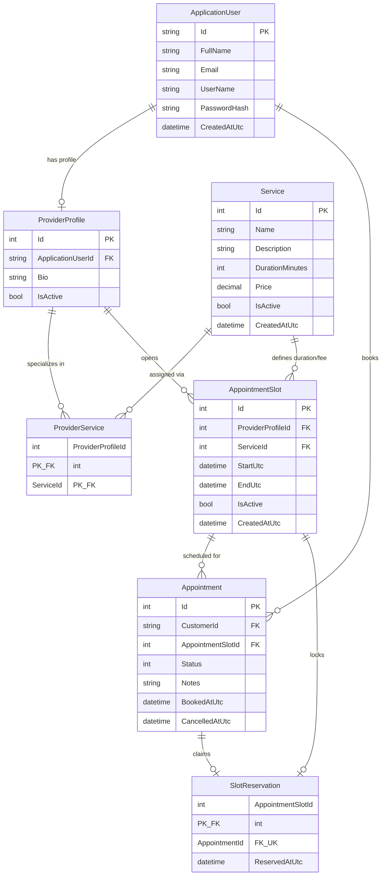

# System Architecture: BookMySlot

## 1. Overview
**BookMySlot** is an appointment booking web application built using **ASP.NET Core MVC** (.NET 10) and **Entity Framework Core** with **SQLite**. The system follows a clean Model-View-Controller pattern with separation between presentation, controller orchestration, transactional business logic, and relational database persistence.

---

## 2. Request Flow Architecture

### Request Flow Steps
1. **HTTP Ingestion:** The client sends an HTTP GET or POST request to the application.
2. **Middleware Pipeline:** ASP.NET Core processes HTTPS redirection, static assets (`/wwwroot`), session state (`HttpContext.Session`), and authentication cookies (`CookieAuthenticationMiddleware`).
3. **Controller Orchestration:** The matched controller action executes. For form submissions, model binding and data annotation validations are verified (`ModelState.IsValid`).
4. **Service Delegation:** Controllers delegate business operations to dedicated services (`BookingService`, `ServiceCatalogService`, `TimeZoneService`) instead of performing direct heavy database operations inside controller actions.
5. **Atomic Persistence:** Database operations are wrapped inside database transactions (`BeginTransactionAsync`). Concurrency locks are managed via the dedicated `SlotReservation` table.
6. **PRG & View Rendering:** State-changing requests follow the **Post/Redirect/Get** pattern, populating `TempData` for success/error flash banners and redirecting to the relevant view.

---

## 3. Entity-Relationship (ER) Diagram

---

## 4. Double-Booking Prevention & Concurrency Strategy

### The Problem
When two customers attempt to book the exact same slot at the exact same millisecond, a standard `SELECT ... WHERE IsBooked == false` followed by `INSERT` will suffer from a race condition (read-skew), allowing both bookings to pass.

### The Solution: Database-Level Slot Reservation
To guarantee 100% protection against concurrent double-booking:
1. **The `SlotReservation` Table:**
   - Has `AppointmentSlotId` as its **Primary Key**.
   - Has `AppointmentId` as a **Unique Foreign Key**.
2. **Transaction Isolation:**
   - `BookingService.BookAppointmentAsync` initiates a database transaction with `Serializable` isolation level.
3. **Physical Engine Constraint:**
   - When a booking occurs, an `Appointment` record is added and immediately followed by an insertion into `SlotReservations(AppointmentSlotId, AppointmentId)`.
   - If two requests run simultaneously, the first request inserts into `SlotReservations` and commits.
   - The second request attempts to insert the same `AppointmentSlotId` into the primary key column of `SlotReservations`, triggering an immediate database constraint violation (`DbUpdateException`).
   - The exception is caught, the transaction rolls back, and the second user receives a clear, friendly error message: *"This slot was just reserved by another customer. Please choose a different time slot."*
4. **Atomic Rescheduling:**
   - Rescheduling deletes the old `SlotReservation` and inserts the new `SlotReservation` inside the same transaction.
   - If the new slot is unavailable, the transaction rolls back, leaving the customer's original appointment completely intact.
5. **Slot Cancellation:**
   - Cancelling an appointment updates the `Appointment.Status` to `Cancelled` and removes the row from `SlotReservations`.
   - This releases the slot for re-booking while preserving the appointment history for audits.
